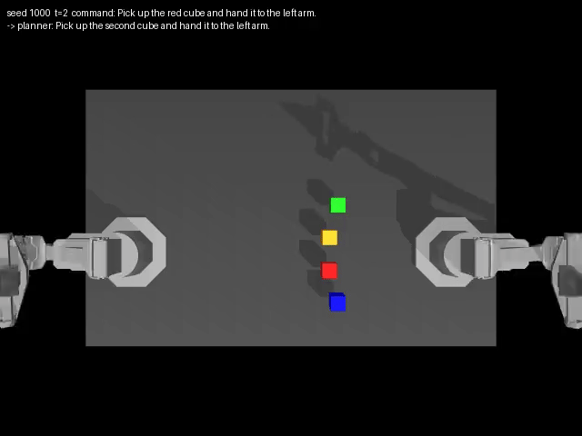
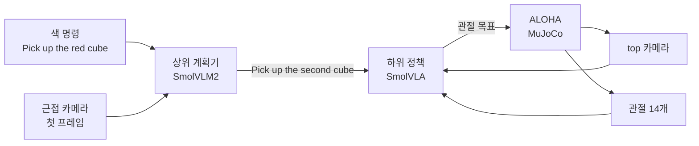

# AlohaVla

[](LICENSE)
[](#환경)


## 🌐 [English version → README_EN.md](README_EN.md)

색 명령("Pick up the red cube ...")을 받아 ALOHA 양팔 로봇이 그 큐브를 집어 왼팔에 넘기는 시스템.
VLM 계획기(SmolVLM2)가 색을 위치로 바꾸고, LeRobot SmolVLA 정책이 실행한다.



**데모 영상 (31초, 원속도):** [demo.mp4](docs/images/demo.mp4)

---

## 빠른 시작

WSL2 Ubuntu 22.04, 저장소 폴더에서 실행.

```bash
bash setup.sh   # 최초 1회: Miniforge + conda env "lerobot" + LeRobot 0.6.1

# 1. 시연 200개 생성 (장면 50 × 4색)
bash run.sh record 200 local/aloha_4cubes_place paired red,blue,orange,green slot

# 2. 하위 정책 학습 (SmolVLA 파인튜닝)
TASK=AlohaFourCubesSlot-v0 DATASET=local/aloha_4cubes_place POLICY=smolvla bash run.sh train 20000 5000

# 3. 상위 계획기 학습 (SmolVLM2)
source ~/miniforge3/etc/profile.d/conda.sh && conda activate lerobot
MUJOCO_GL=egl python planner.py train outputs/planner 2000 500

# 4. 평가 200회 / 명령을 직접 입력해서 보기
CKPT=outputs/train/AlohaFourCubesSlot_smolvla_<시각>/checkpoints/020000/pretrained_model
EVAL_TASK=AlohaFourCubesPlan-v0 PLANNER=outputs/planner bash run.sh eval $CKPT 200
EVAL_TASK=AlohaFourCubesPlan-v0 PLANNER=outputs/planner bash run.sh view $CKPT
```

`view`는 MuJoCo 창을 띄우고 터미널에서 명령을 받는다 (예: `Pick up the green cube and hand it to the left arm.`).

---

## 개요

| 항목 | 내용 |
|------|------|
| 로봇 | ALOHA 양팔 (ViperX 300 ×2, 14 joint), gym-aloha MuJoCo 시뮬레이션 |
| 작업 | 4색 큐브(빨강·파랑·주황·초록) 중 명령한 색을 오른팔로 집어 왼팔에 전달 |
| 상위 계획기 | SmolVLM2-500M: 근접 카메라 첫 프레임 → 색 순서 → 위치 명령 |
| 하위 정책 | SmolVLA (450M): top 카메라 + 관절 + 위치 명령 → 관절 목표 (50 step 단위) |
| 학습 데이터 | 스크립트 시연 200개, 계획기용 자동 라벨 이미지 2,000장 |
| 평가 | 학습에 없던 장면 200개, 500 step 제한 |

---

## 결과

| 방식 | 성공률 (200회) |
|------|----------------|
| SmolVLA 단일 정책 (색 명령으로 학습) | 14.5% |
| **계획기 + SmolVLA** | **94.0%** (95% CI 89.8–96.5%) |

- 성공: 왼팔이 명령한 큐브를 혼자 0.5초 이상 들고 있음
- 계획기 정확도 94.0%, 하위 정책 단독(위치 명령) 100%

---

## 아키텍처



| 블록 | 실행 | 파일 |
|------|------|------|
| 상위 계획기 | 에피소드 시작 때 1회 | `planner.py` (`read_order`), `two_cubes.py` (`plan`) |
| 하위 정책 | 매 스텝 | LeRobot SmolVLA (`lerobot/smolvla_base` 파인튜닝) |
| 환경 | 매 스텝 | `two_cubes.py` (`TwoCubesEnv`) |

두 모델은 문장 하나로 연결된다: 계획기가 만든 위치 명령이 정책의 언어 입력이 된다.

---

## 학습

| | 하위 정책 | 상위 계획기 |
|------|------|------|
| 모델 | `lerobot/smolvla_base` (450M) | `SmolVLM2-500M-Video-Instruct` |
| 데이터 | 스크립트 시연 200개 (같은 배치 × 4색) | 근접 화면 2,000장 + 정답 색 순서 (자동 라벨) |
| 학습 범위 | VLM 고정, action expert만 | 비전 인코더 고정, 언어 모델 |
| 설정 | 20k step, batch 32 | 500 step, batch 8, lr 1e-5 |
| 시간 (RTX 4070 SUPER) | 약 2.5시간 (중간 평가 포함) | 약 1시간 |

시연: 엔드이펙터 웨이포인트 스크립트 → 관절 궤적 → 정책 환경에서 재생하며 기록 (ACT 시뮬레이션 데이터 방식).

---

## 프로젝트 구조

```
├── run.sh          # 진입점: record / train / eval / view
├── two_cubes.py    # 4색 큐브 환경·보상, 스크립트 시연, 계획기 연결, 분석
├── planner.py      # 상위 계획기 학습·평가
├── view.py         # MuJoCo 뷰어 + 명령 입력
├── stats.py        # 성공률 95% CI, 같은 seed 비교 (McNemar)
├── setup.sh        # WSL 환경 설치
└── docs/images/
```

---

## 환경

| 항목 | 버전 / 값 |
|------|-----------|
| OS | Windows 11 + WSL2 Ubuntu 22.04 |
| GPU | NVIDIA GeForce RTX 4070 SUPER (12GB) |
| Python | 3.12 |
| LeRobot | 0.6.1 |
| PyTorch | 2.11 |
| 시뮬레이터 | gym-aloha 0.1.5 (MuJoCo 3.8, dm_control) |
| transformers | 5.5 |

---

## 라이선스

MIT © [kmikesierra01](https://github.com/kmikesierra01)
