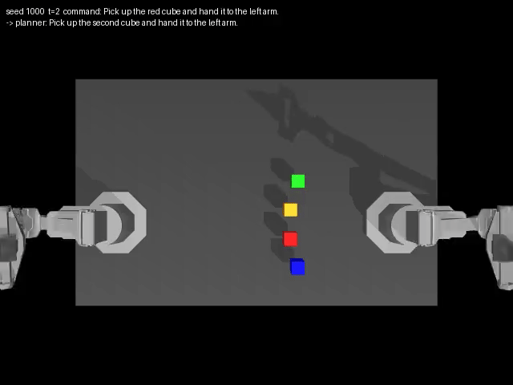
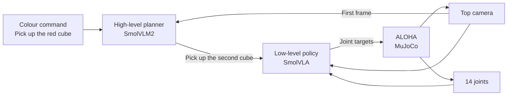

# AlohaVla

[](LICENSE)
[](#environment)


## 🌐 [한국어 버전 → README.md](README.md)

An ALOHA bimanual robot takes a colour command ("Pick up the red cube ..."), picks up that cube and hands it to the left arm.
A VLM planner (SmolVLM2) turns the colour into a place; a LeRobot SmolVLA policy executes it.



**Demo video (31 s, real time):** [demo.mp4](docs/images/demo.mp4)

---

## Quick Start

Run from the repository folder in WSL2 Ubuntu 22.04.

```bash
bash setup.sh   # once: Miniforge + conda env "lerobot" + LeRobot 0.6.1

# 1. Record 200 demos (50 layouts × 4 colours)
bash run.sh record 200 local/aloha_4cubes_place paired red,blue,orange,green slot

# 2. Train the low-level policy (SmolVLA fine-tuning)
TASK=AlohaFourCubesSlot-v0 DATASET=local/aloha_4cubes_place POLICY=smolvla bash run.sh train 20000 5000

# 3. Train the high-level planner (SmolVLM2)
source ~/miniforge3/etc/profile.d/conda.sh && conda activate lerobot
MUJOCO_GL=egl python planner.py train outputs/planner 2000 500

# 4. Evaluate 200 episodes / type commands yourself
CKPT=outputs/train/AlohaFourCubesSlot_smolvla_<time>/checkpoints/020000/pretrained_model
EVAL_TASK=AlohaFourCubesPlan-v0 PLANNER=outputs/planner bash run.sh eval $CKPT 200
EVAL_TASK=AlohaFourCubesPlan-v0 PLANNER=outputs/planner bash run.sh view $CKPT
```

`view` opens a MuJoCo window and reads commands from the terminal (e.g. `Pick up the green cube and hand it to the left arm.`).

---

## Overview

| Item | Description |
|------|-------------|
| Robot | ALOHA bimanual (2 × ViperX 300, 14 joints), gym-aloha MuJoCo simulation |
| Task | Of four cubes (red, blue, orange, green), pick the commanded one with the right arm and hand it to the left |
| High-level planner | SmolVLM2-500M: first top camera frame → colour order → place command |
| Low-level policy | SmolVLA (450M): top camera + joints + place command → joint targets (50-step chunks) |
| Training data | 200 scripted demos, 2,000 auto-labelled images for the planner |
| Evaluation | 200 unseen layouts, 500-step limit |

---

## Results

| Method | Success (200 episodes) |
|--------|------------------------|
| Single SmolVLA policy (trained on colour commands) | 14.5% |
| **Planner + SmolVLA** | **99.0%** (95% CI 96.4–99.7%) |

- Success: the left gripper alone holds the commanded cube for 0.5 s
- Planner accuracy (commanded cube's place) 99.5%, low-level policy alone (place commands) 100%
- The orange cube renders yellowish, so the planner is trained to call it "yellow" (trained on "orange": 95.0%)

---

## Architecture



| Block | Runs | Files |
|-------|------|-------|
| High-level planner | Once per episode | `planner.py` (`read_order`), `two_cubes.py` (`plan`) |
| Low-level policy | Every step | LeRobot SmolVLA (fine-tuned `lerobot/smolvla_base`) |
| Environment | Every step | `two_cubes.py` (`TwoCubesEnv`) |

The two models are linked by one sentence: the planner's place command is the policy's language input.

---

## Training

| | Low-level policy | High-level planner |
|------|------|------|
| Model | `lerobot/smolvla_base` (450M) | `SmolVLM2-500M-Video-Instruct` |
| Data | 200 scripted demos (same layout × 4 colours) | 2,000 top camera images + true colour order (auto-labelled) |
| Trained | Action expert only, VLM part frozen | Language model, vision encoder frozen |
| Settings | 20k steps, batch 32 | 500 steps, batch 8, lr 1e-5 |
| Time (RTX 4070 SUPER) | ~2.5 h (incl. periodic evals) | ~10 min |

Demos: end-effector waypoint script → joint trajectory → replayed and recorded in the policy's environment (ACT's sim data recipe).

---

## Project Structure

```
├── run.sh          # entry point: record / train / eval / view
├── two_cubes.py    # four-cube env and reward, scripted demos, planner hook, analysis
├── planner.py      # high-level planner training and evaluation
├── view.py         # MuJoCo viewer + command input
├── stats.py        # success 95% CI, same-seed comparison
├── setup.sh        # WSL environment setup
└── docs/images/
```

---

## Environment

| Item | Version / Value |
|------|-----------------|
| OS | Windows 11 + WSL2 Ubuntu 22.04 |
| GPU | NVIDIA GeForce RTX 4070 SUPER (12 GB) |
| Python | 3.12 |
| LeRobot | 0.6.1 |
| PyTorch | 2.11 |
| Simulator | gym-aloha 0.1.5 (MuJoCo 3.8, dm_control) |
| transformers | 5.5 |

---

## License

MIT © [kmikesierra01](https://github.com/kmikesierra01)
